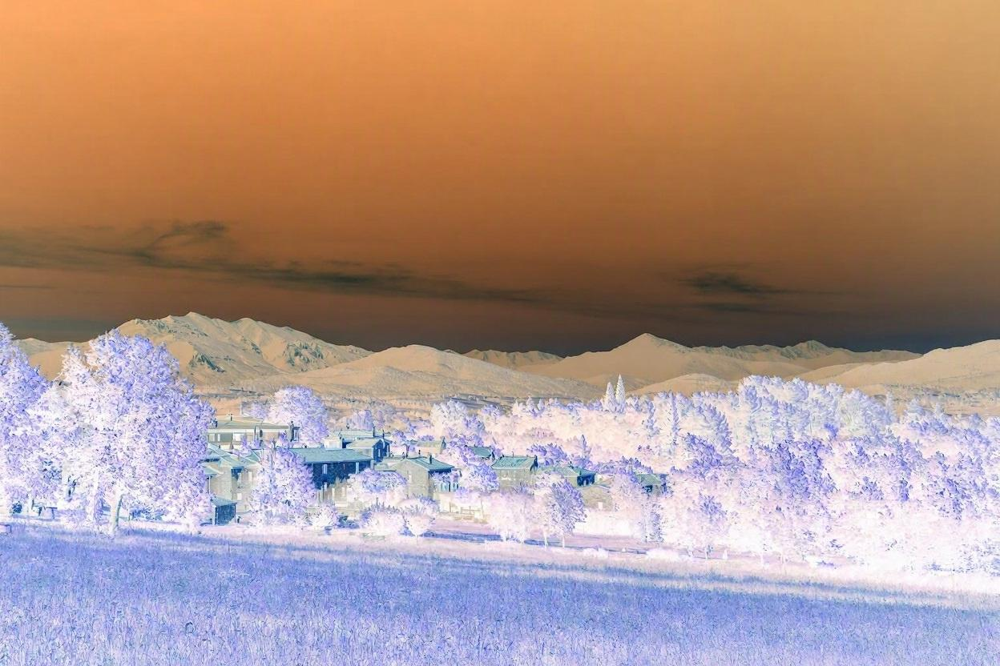

# Matrix Operations and Photo Filters

A Python-based mini-project for **Mathematical Foundation for AI & Data Science** (Course Code: **UE25MA242A**) at PES University.

This project demonstrates matrix multiplication and matrix inversion, and shows how digital images can be represented as numerical arrays. It applies three image transformations: brightness, negative, and contrast.

## Team

| Name | SRN |
|---|---|
| Aditya Kumar P | PES1UG25CS036 |
| A B Sharvesh | PES1UG25CS001 |
| Abhinav Akinepalli | PES1UG25CS013 |

## Features

### Matrix operations
- Multiplies two matrices using NumPy.
- Calculates the inverse of a square, nonsingular matrix.
- Verifies the inverse by checking whether `A @ A_inv` is approximately the identity matrix.

### Image representation
- Loads an RGB photograph using Pillow.
- Converts the image into a NumPy array.
- Prints the image dimensions, array shape, and sample pixel values.

### Image filters
- **Brightness:** adds 50 to each channel value and clips values to 0–255.
- **Negative:** transforms each channel value `I` into `255 - I`.
- **Contrast:** applies `128 + 1.5 * (I - 128)` and clips the result to 0–255.

## Technologies

- Python
- NumPy
- Pillow (PIL)

## Project structure

```text
Matrix-Operations-Photo-Filters/
├── matrix_operations.py
├── image_processing.py
├── myphoto.jpg
├── brightened_photo.jpg
├── negative_photo.jpg
├── contrast_photo.jpg
├── Matrix_Operations_and_Photo_Filters_Mini_Project.pptx
├── README.md
├── requirements.txt
└── .gitignore
```

## Setup and execution

### 1. Install Python
Install Python 3 if it is not already installed.

### 2. Download or clone the repository

```bash
git clone <repository-url>
cd Matrix-Operations-Photo-Filters
```

Alternatively, download the repository as a ZIP file from GitHub and extract it.

### 3. Install dependencies

```bash
pip install -r requirements.txt
```

### 4. Run matrix operations

```bash
python matrix_operations.py
```

This prints the sample matrices, their product, the inverse of matrix A, and the inverse verification result.

### 5. Run image processing

Keep `myphoto.jpg` in the same folder as `image_processing.py`, then run:

```bash
python image_processing.py
```

The script generates `brightened_photo.jpg`, `negative_photo.jpg`, and `contrast_photo.jpg`, and prints the input image dimensions, array shape, and sample pixel values.

## Sample image results

The following are the outputs generated using `myphoto.jpg`.

### Original


### Brightness


### Negative


### Contrast


## Sample matrix calculations

For the sample matrices:

```text
A = [[2, 1],
     [1, 1]]

B = [[3, 2],
     [4, 5]]
```

Their product is:

```text
A × B = [[10, 9],
         [ 7, 7]]
```

The inverse of A is:

```text
A⁻¹ = [[ 1, -1],
       [-1,  2]]
```

And:

```text
A × A⁻¹ = [[1, 0],
           [0, 1]]
```

For an 8-bit RGB image, each pixel has red, green, and blue channel values in the range 0–255. The sample input image is **1248 × 832 pixels**; its NumPy array shape is **832 × 1248 × 3**.

## Notes

- `image_processing.py` expects the input image to be named `myphoto.jpg` and stored beside the script.
- Matrix inversion requires a square matrix with a non-zero determinant.
- The output images are included so the results can be viewed without running the code.

---
**Academic mini-project — UE25MA242A, Mathematical Foundation for AI & Data Science.**
